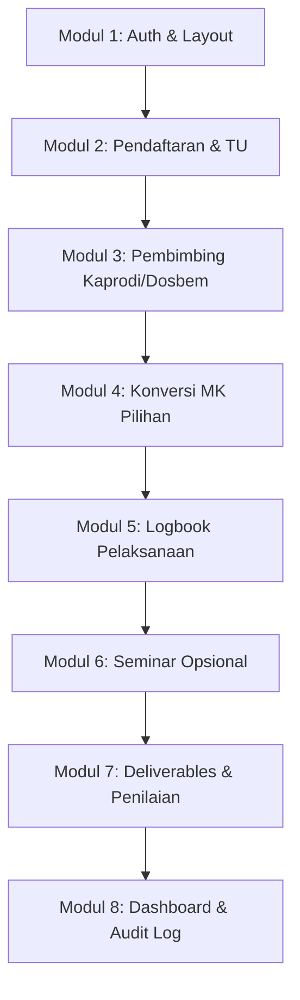

# Panduan & Rencana Persiapan Coding SIMAGANG

Dokumen ini berisi panduan dan rencana persiapan pengembangan aplikasi **SIMAGANG** (Sistem Informasi Magang) berbasis **CodeIgniter 4**, **Tailwind CSS**, dan **MySQL**.

---

## 📋 Tahap 1: Konfirmasi & Alignment Requirement (Pre-Development)

Sebelum memulai penulisan kode (*coding*), beberapa poin aturan bisnis yang masih terbuka disepakati terlebih dahulu:

1. **Kelengkapan Dokumen Wajib Pendaftaran**
   - Dokumen dasar: Surat Pengantar dari Kampus & Surat Balasan/Pendukung Instansi.
   - Dokumen tambahan lain (jika ada): Transkrip Nilai, Proposal Magang, atau CV (perlu dipastikan).
2. **Batasan Konversi MK Pilihan**
   - Batas maksimal jumlah mata kuliah pilihan yang dapat dikonversi.
   - Batas maksimal total SKS yang diizinkan untuk konversi.
3. **Skema & Rubrik Penilaian Akhir**
   - Komponen penilaian standar (misal: Nilai Instansi, Logbook, Laporan/Proyek, Seminar).
   - Bobot masing-masing komponen penilaian.

---

## ⚡ Prinsip Pengolahan Dependensi & Lingkungan Server Kampus

> [!IMPORTANT]
> **Prinsip Bebas Dependensi Server (Zero Runtime NPM on Server):**
> 1. **Server Production Murni PHP & MySQL**: Server produksi kampus tidak memerlukan Node.js atau NPM.
> 2. **Kompilasi Lokal**: Process kompilasi Tailwind CSS dilakukan sepenuhnya di lingkungan *local development*. File hasil kompilasi (`public/css/style.css`) dikomit/diunggah langsung ke server sebagai file CSS statis biasa.
> 3. **Native CodeIgniter 4 Features**: Utamakan fitur bawaan CI4 (Native Session, Native Validation, Native File Uploader, Native Database Builder) daripada menambah library vendor/composer yang tidak perlu.
> 4. **Vanilla JavaScript Murni**: Interaktivitas frontend (seperti modal, dropdown, toggle sidebar, preview file) dibuat menggunakan Vanilla JS murni tanpa library JS eksternal yang memberatkan.

---

## ⚙️ Tahap 2: Inisialisasi Environment & Proyek CodeIgniter 4


### 2.1 Persyaratan Lingkungan Pengembangan (Prerequisites)
- **PHP**: Versi $\ge 8.1$ dengan ekstensi aktif: `intl`, `mbstring`, `mysqli`, `json`, `curl`, `gd` / `fileinfo`.
- **Composer**: Versi 2.x.
- **Node.js & NPM**: Versi 18.x atau 20.x (untuk kompilasi Tailwind CSS).
- **Database**: MySQL 8.0 atau MariaDB 10.4+.

### 2.2 Inisialisasi Project CodeIgniter 4
```bash
# Inisialisasi proyek CodeIgniter 4 menggunakan Composer di folder saat ini
composer create-project codeigniter4/appstarter .
```

### 2.3 Konfigurasi Environment (`.env`)
- Salin `env` menjadi `.env`:
  ```ini
  CI_ENVIRONMENT = development
  app.baseURL = 'http://localhost:8080/'

  database.default.hostname = localhost
  database.default.database = simagang_db
  database.default.username = root
  database.default.password = 
  database.default.DBDriver = MySQLi
  database.default.DBPrefix = 
  database.default.port = 3306
  ```

### 2.4 Setup & Integrasi Tailwind CSS
1. Install Tailwind CSS, PostCSS, dan Autoprefixer via NPM:
   ```bash
   npm init -y
   npm install -D tailwindcss postcss autoprefixer
   npx tailwindcss init -p
   ```
2. Konfigurasi `tailwind.config.js`:
   ```javascript
   module.exports = {
     content: [
       "./app/Views/**/*.php",
       "./public/**/*.js"
     ],
     theme: {
       extend: {
         colors: {
           primary: {
             50: '#f0f7ff',
             100: '#e0effe',
             500: '#1d4ed8',
             600: '#1e40af',
             700: '#1d3557', // Navy primary
             800: '#0f172a',
           },
           secondary: '#64748b', // Slate
         }
       },
     },
     plugins: [],
   }
   ```
3. Buat file CSS utama (`src/input.css`) dan daftarkan directive Tailwind:
   ```css
   @tailwind base;
   @tailwind components;
   @tailwind utilities;
   ```
4. Tambahkan script build di `package.json` untuk mengompilasi CSS ke `public/css/style.css`.

---

## 🗄️ Tahap 3: Perancangan Database, Migration & Seeder

### 3.1 Urutan Pembuatan File Migration (`app/Database/Migrations/`)
Migration dibuat secara berurutan sesuai dependensi *foreign key*:

1. `2026-10-01-000001_CreateProgramStudiesTable.php` (Master Program Studi)
2. `2026-10-01-000002_CreateUsersTable.php` (`role`: `mahasiswa`, `tu`, `kaprodi`, `dosen_pembimbing`, `dosen_mk`, `wadek1`, `admin`)
3. `2026-10-01-000003_CreateStudentsTable.php` (Profil Mahasiswa: FK `user_id`, `program_study_id`, NIM, No. HP, Alamat)
4. `2026-10-01-000004_CreateLecturersTable.php` (Profil Dosen: FK `user_id`, `program_study_id`, NIDN)
5. `2026-10-01-000005_CreateCoursesTable.php` (Master Mata Kuliah: FK `program_study_id`, `lecturer_id`, `is_elective`)
6. `2026-10-01-000006_CreateInternshipsTable.php` (Periode Magang Mahasiswa: FK `student_id`, Nama Instansi, Alamat, Tanggal, `academic_year`, `semester`, Status)
7. `2026-10-01-000007_CreateInternshipDocumentsTable.php` (Dokumen Administrasi Pendaftaran: FK `internship_id`, jenis dokumen, path file, status verifikasi TU, catatan)
8. `2026-10-01-000008_CreateSupervisorAssignmentsTable.php` (Penugasan Dosbem: FK `internship_id`, `lecturer_id`, assigned_by, status `PENDING`/`ACCEPTED`/`REJECTED`, alasan penolakan)
9. `2026-10-01-000009_CreateInternshipLogbooksTable.php` (Logbook Mingguan: FK `internship_id`, minggu ke, tanggal, aktivitas, kendala, lampiran, status `SUBMITTED`/`VERIFIED`/`REVISION_REQUIRED`, catatan dosbem)
10. `2026-10-01-000010_CreateConversionRequestsTable.php` (Pengajuan Konversi: FK `internship_id`, `student_id`, overall status)
11. `2026-10-01-000011_CreateConversionRequestCoursesTable.php` (Detail MK Konversi: FK `conversion_request_id`, `course_id`, status persetujuan Dosen MK, alasan penolakan)
12. `2026-10-01-000012_CreateConversionApprovalsTable.php` (Jejak Approver: FK `conversion_request_id`, `approver_id`, `role`, status, catatan, timestamp)
13. `2026-10-01-000013_CreateSeminarsTable.php` (Seminar Opsional: FK `internship_id`, `course_id`, `is_required`, jadwal, lokasi, status, nilai)
14. `2026-10-01-000014_CreateAssessmentComponentsTable.php` (Komponen Pengumpulan Dinamis oleh Dosen MK: FK `course_id`/`internship_id`, nama komponen, deskripsi, bobot, max score)
15. `2026-10-01-000015_CreateInternshipSubmissionsTable.php` (Pengumpulan Berkas/Deliverables oleh Mahasiswa: FK `assessment_component_id`, `internship_id`, file path, status `SUBMITTED`/`APPROVED`/`REVISION_REQUIRED`, feedback)
16. `2026-10-01-000016_CreateAssessmentsTable.php` (Penilaian Akhir: FK `internship_id`, `course_id`, `assessor_id`, score, final_grade, verified_status)
17. `2026-10-01-000017_CreateNotificationsTable.php` (Notifikasi Sistem: FK `user_id`, title, message, link, read_at)
18. `2026-10-01-000018_CreateActivityLogsTable.php` (Audit Log Activity: FK `user_id`, action, module, description, IP)


### 3.2 Master Seeder (`app/Database/Seeds/`)
Menyiapkan Seeder dummy data untuk testing pengujian alur lengkap:
- `ProgramStudySeeder` (Contoh: Teknik Informatika, Sistem Informasi).
- `UserSeeder` (Akun test untuk ke-6 role).
- `CourseSeeder` (Mata kuliah pilihan & pengampu).

---

## 🔐 Tahap 4: Core Architecture, Auth & Authorization (RBAC)

### 4.1 Base Model & Helper
- Menyiapkan Base Model dengan timestamps (`created_at`, `updated_at`, `deleted_at` untuk soft deletes).
- Helper khusus: `activity_log_helper.php`, `upload_helper.php`, `status_badge_helper.php`.

### 4.2 Middleware Filter RBAC (`app/Filters/`)
- `AuthFilter`: Memastikan pengguna telah login.
- `RoleFilter`: Memastikan pengguna memiliki akses sesuai perannya (`mahasiswa`, `tu`, `kaprodi`, `dosbem`, `dosen_mk`, `wadek1`).

### 4.3 Structure View Layout (`app/Views/layouts/`)
- `main.php`: Layout utama dengan sidebar, navbar top, flash alert, dan tempat konten.
- `auth.php`: Layout khusus halaman Login.
- Partial views: `_sidebar.php`, `_navbar.php`, `_flash_messages.php`.

### 4.4 Structure View Per Role (Clean Architecture)
Struktur tampilan (*views*) dikelompokkan secara rapi dan modular ke dalam folder terpisah untuk masing-masing role:
- `app/Views/mahasiswa/` (Tampilan khusus role Mahasiswa)
- `app/Views/tu/` (Tampilan khusus role Staf TU)
- `app/Views/kaprodi/` (Tampilan khusus role Kaprodi)
- `app/Views/dosen_pembimbing/` (Tampilan khusus role Dosen Pembimbing)
- `app/Views/dosen_mk/` (Tampilan khusus role Dosen Mata Kuliah)
- `app/Views/wadek1/` (Tampilan khusus role Wadek 1)
- `app/Views/components/` (Komponen UI terisolasi & reusable: `status_badge.php`, `stepper.php`, `alert.php`)

### 4.5 Prinsip Clean Code & Pencegahan Bug
1. **Single Responsibility Principle (SRP)**: Controller hanya mengatur alur request/response (thin controller), Model mengelola kueri data, dan View hanya menampilkan UI murni tanpa query SQL/logika berat.
2. **Penggunaan Component Reusable (DRY)**: Elemen berulang seperti Badge Status atau Stepper menggunakan komponen parcial di `app/Views/components/` agar konsisten dan mudah dirawat.
3. **Type-Safety & Sanitasi Output**: Seluruh nilai variabel yang dirender di View wajib melalui fungsi `esc()` untuk mencegah potensi celah keamanan XSS.
4. **Validasi & Proteksi Strict**: Setiap penginputan form melalui enkapsulasi `$this->validate()` dan pemeriksaan otorisasi role via middleware `RoleFilter`.

---


## 🚀 Tahap 5: Modul Pengembangan (Step-by-Step Feature Building)



### Modul 1: Authenticaton & User Management
- Halaman Login & Logout.
- Redirect otomatis berdasarkan Role setelah Login.
- Edit Profil Mahasiswa & Dosen.

### Modul 2: Pendaftaran Magang & Administrasi TU
- **Mahasiswa**: Form pengajuan magang baru (Instansi, Tanggal, Posisi) + Upload Surat Pengantar & Surat Balasan.
- **TU**: Dashboard Administrasi, Verifikasi kelengkapan berkas, ubah status ke `ADMIN_APPROVED` atau `REVISION_REQUIRED`.

### Modul 3: Penentuan Dosen Pembimbing
- **Kaprodi**: Dashboard penentuan Dosen Pembimbing untuk pengajuan yang telah disetujui TU.
- **Dosen Pembimbing**: Notifikasi penugasan, aksi Terima/Tolak pengajuan pembimbingan.

### Modul 4: Pengajuan Konversi Mata Kuliah Pilihan
- **Mahasiswa**: Memilih MK Pilihan yang sedang berjalan pada periode magang.
- **Dosen MK**: Memeriksa kesesuaian CPMK magang $\rightarrow$ Setuju / Tolak.
- **Dosen Pembimbing**: Memverifikasi pengajuan konversi.
- **Wadek 1**: Memverifikasi & mengetahui pengajuan konversi.
- **Kaprodi**: Memverifikasi final konversi.

### Modul 5: Logbook Magang Wajib
- **Mahasiswa**: Input logbook mingguan (Tanggal, Aktivitas, Hasil, Kendala, Lampiran foto/file).
- **Dosen Pembimbing**: Memeriksa logbook $\rightarrow$ Verifikasi (`VERIFIED`) atau Minta Revisi (`REVISION_REQUIRED`).

### Modul 6: Seminar Magang (Opsional)
- **Dosen MK**: Menentukan status butuh seminar (`is_required = true/false`).
- Jika butuh seminar: Dosen MK set jadwal & lokasi $\rightarrow$ Notifikasi ke Dosbem, Wadek 1, Kaprodi $\rightarrow$ Pelaksanaan $\rightarrow$ Input nilai seminar oleh Dosen MK.

### Modul 7: Deliverables & Penilaian Akhir
- **Dosen MK**: Pengaturan komponen pengumpulan dinamis (Laporan Akhir, Proyek, dll.).
- **Mahasiswa**: Upload deliverables akhir.
- **Dosen MK**: Mengisi skor tiap komponen pengumpulan $\rightarrow$ Kalkulasi nilai akhir $\rightarrow$ Verifikasi nilai akhir.

### Modul 8: Dashboard Role-Specific & Audit Trail
- Dashboard ringkasan khusus untuk masing-masing dari 6 Role.
- Logging aktivitas penting di tabel `activity_logs`.

---

## 🧪 Tahap 6: Testing & Quality Assurance

1. **Unit & Integration Testing (PHPUnit)**
   - Test alur transisi status workflow magang & konversi.
   - Test enkapsulasi RBAC (mencegah mahasiswa mengakses menu TU/Kaprodi).
2. **Security Verification**
   - Memastikan validasi file upload (tipe MIME, ukuran file max, anti-script execution).
   - Memastikan perlindungan CSRF aktif di seluruh form POST/PUT.
3. **Responsive UI Verification**
   - Uji tampilan pada resolusi Mobile (360px, 390px), Tablet (768px), dan Desktop (1280px+).

---

## 📦 Tahap 7: Preparasi Deployment Production (Server Kampus)

1. **Build Assets Secara Lokal**: Kompilasi CSS Tailwind di lokal (`npm run build`), menghasilkan `public/css/style.css` statis murni.
2. **Unggah File Statis**: File `public/css/style.css` diunggah ke server kampus (Server tidak perlu menjalankan `npm install` atau `npm run build`).
3. **Production Environment**: Konfigurasi file `.env` produksi (`CI_ENVIRONMENT = production`, matikan debug toolbar).
4. **Database Migration**: Jalankan `php spark migrate --all` pada server (atau import SQL migration secara manual via phpMyAdmin jika CLI dibatasi).
5. **Permissions & Storage**: Setting izin folder `writable/` (`chmod -R 775 writable`).

